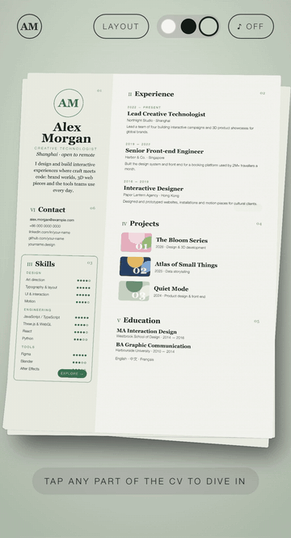
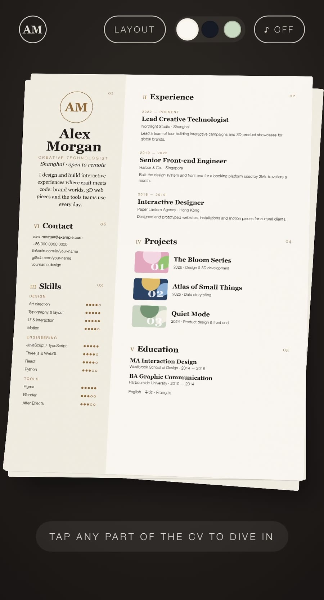
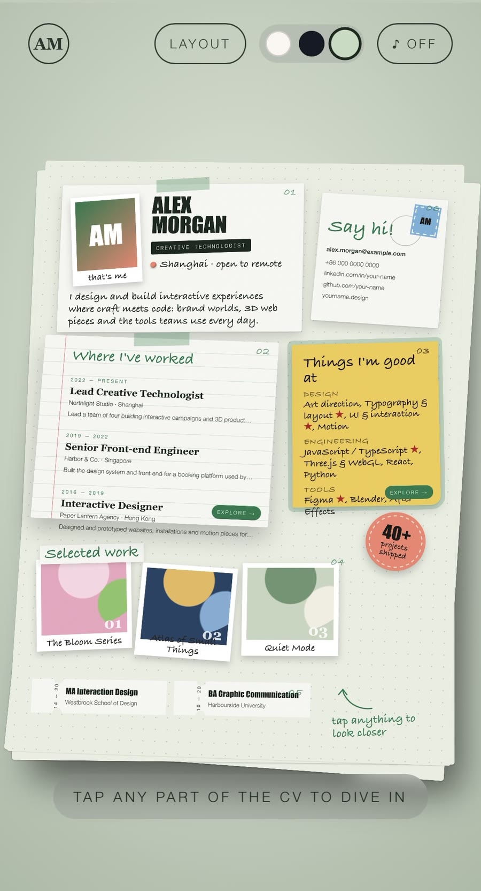

# Zoomfolio: a CV you zoom into

**[▶ Live demo](https://kheleey.github.io/zoomfolio/)** · Free to use under the [MIT License](LICENSE)

### 🎬 Video tour

**[▶ Watch the full video tour](https://kheleey.github.io/zoomfolio/tour.mp4)**

### Screenshots

<table><tr><td align="center"> The whole CV</td><td align="center"> Zoomed into the profile</td><td align="center"> Collage layout</td><td align="center"> Playful layout</td></tr></table>

The whole CV on one floating page. Tap any section and the view gently zooms into it, where that section has its own design:

- **Profile:** an editorial layout
- **Experience:** a timeline
- **Skills:** gauges
- **Projects:** a gallery
- **Education:** certificates
- **Contact:** a letter

Move to the next section with the dropdown, the arrows, a swipe or the arrow keys.

- **Formal layouts:** Classic, Sidebar, Editorial and Bento.
- **Creative layouts:** Collage, Poster and Playful.
- **Colour themes:** Ivory, Noir and Sage.
- **Sound:** an optional whoosh.

## Make it yours

Edit the `window.CV` block near the top of `index.html`: name, role, contact, experience, projects, skills, education, awards and languages.

## Built with

A single HTML file of plain HTML, CSS and JavaScript, with fonts from Google Fonts.

## Use it for your own

1. Click **Fork** at the top of this page, or **Code → Download ZIP**.
2. Open `index.html` in any text editor and change the content block near the top.
3. Publish it with GitHub Pages (below), or open `index.html` in a browser.

Free to use, change and share, including commercially. Please keep the `LICENSE` file.

## Publish it as a website (GitHub Pages)

1. Upload this folder's files to a new **public** GitHub repository.
2. Go to **Settings → Pages**, choose **Deploy from a branch**, pick `main` and `/ (root)`, then click **Save**.
3. After a minute or two it's live at `https://<your-username>.github.io/<repo-name>/`.

You can also just open `index.html` in a browser.

## License

MIT. See [LICENSE](LICENSE).
